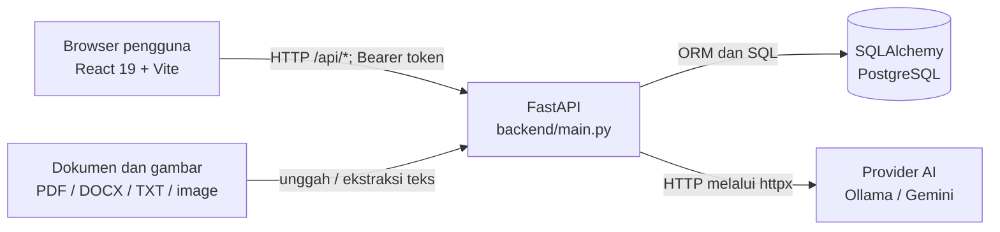

# Arsitektur TKA TryOut AI

Dokumen ini menggambarkan arsitektur yang terlihat pada kode repository saat ini. Ini bukan jaminan bahwa setiap deployment menggunakan konfigurasi yang sama; nilai environment saat runtime menentukan database, provider AI, dan alamat layanan.

## Gambaran sistem

Dalam mode pengembangan, `run.py` menjalankan backend dan frontend untuk komputer lokal. `run_server.py` menjalankan keduanya pada antarmuka jaringan agar perangkat di LAN dapat mengaksesnya. Pada Docker Compose, frontend dibangun menjadi file statis dan disajikan Nginx; backend berjalan sebagai layanan FastAPI terpisah.

## Frontend

- Entry point React berada di `frontend/src/main.jsx`; routing halaman dan pembatasan akses berbasis peran berada di `frontend/src/App.jsx`.
- Halaman dan komponen dibagi menurut fitur/peran di `frontend/src/pages/` dan `frontend/src/components/`. State autentikasi dan tampilan bersama dikelola oleh `AuthContext` dan `UIContext`.
- `frontend/src/services/api.js` menyediakan wrapper `fetch`, menambahkan token bearer dari `localStorage`, memproses respons/error, dan menangani respons 401.
- URL API menggunakan `VITE_API_URL` bila diatur. Jika tidak, frontend memakai protokol dan hostname halaman saat ini dengan port `8000`; ini mendukung akses LAN tanpa menanam `localhost` ke klien.
- Halaman sekunder memakai `React.lazy` untuk pemisahan kode. Hook, service, dan utilitas terpisah membantu memisahkan pengambilan data serta logika UI.

## Backend

- `backend/main.py` membentuk aplikasi FastAPI, mengatur CORS dan penanganan validasi, menjalankan pembuatan tabel/bootstrap saat startup, lalu memasang router.
- Router dipisahkan berdasarkan domain: autentikasi, pengguna, admin, mata pelajaran, soal, tryout, attempt, siswa, guru, pengaturan, notifikasi, sistem, dan impor gambar.
- `backend/schemas.py` berisi kontrak validasi request/response; `backend/models.py` berisi model SQLAlchemy; `backend/dependencies.py` dan `backend/auth.py` menangani dependensi autentikasi serta otorisasi.
- Operasi ORM menggunakan `Session` SQLAlchemy sinkron melalui `get_db()` dan sesi ditutup setelah request. Database engine memakai pooling SQLAlchemy; `pool_pre_ping` dinyalakan untuk PostgreSQL. Ini tidak berarti setiap request pasti membuat koneksi fisik baru.
- Logika provider AI terpusat di `backend/ai_providers.py`, dengan registry provider dan panggilan HTTP asinkron. Pemrosesan gambar dan dokumen dibantu modul `ai_vision.py`, `document_parser.py`, dan layanan impor terkait.

## Domain data

Model utama di `backend/models.py` meliputi:

- Identitas dan peran: `User`, `Student`, `Teacher`.
- Materi: `Subject`, `Question`, `QuestionOption`.
- Ujian: `Tryout`, `TryoutQuestion`, `Attempt`, `Answer`, `Result`.
- Pendukung aplikasi: `Notification`, `AppSetting`.

Relasi antarentitas dan aturan database menjadi sumber kebenaran untuk integritas data. Daftar kolom dan relasi rinci dapat dilihat di `backend/models.py`, `SCHEMA_DOCS.md`, dan `ERD.mermaid`.

## Cakupan fitur dan peran

- **Admin** mengelola pengguna dan data master, memantau dashboard, melihat rekap nilai seluruh tryout, serta mengatur layanan AI dan konfigurasi aplikasi.
- **Guru** mengelola mata pelajaran yang menjadi kewenangannya, bank soal dan paket tryout, peserta, rekap nilai, laporan analitik, serta profil.
- **Siswa** melihat tryout, mengerjakan ujian dengan timer yang divalidasi backend, dan mengakses riwayat nilai serta pembahasan.
- Tipe soal yang didukung mencakup pilihan ganda (`MULTIPLE_CHOICE`), pilihan ganda kompleks/MCMA (`MULTIPLE_RESPONSE`), dan kategori Benar/Salah (`TRUE_FALSE`) dengan label yang dapat dikustomisasi.
- Fitur pendukung mencakup impor soal dari dokumen/gambar, bantuan AI untuk membuat soal dan pembahasan, pemindaian duplikat, notifikasi, ekspor rekap nilai, dan pencatatan perpindahan tab saat ujian.

Rute frontend dibatasi menurut peran, tetapi otorisasi sebenarnya tetap ditegakkan oleh backend:

| Peran | Cakupan utama |
|---|---|
| Admin | `/dashboard`, `/users`, `/students`, `/teachers`, `/subjects`, `/questions`, `/tryouts`, `/admin/scores`, `/admin/reports`, `/admin/settings` |
| Guru | `/dashboard`, `/subjects`, `/questions`, `/tryouts`, `/teacher/students`, `/teacher/scores`, `/teacher/reports`, `/teacher/profile` |
| Siswa | `/dashboard`, `/student/tryouts`, `/student/attempt/:id`, `/student/history`, `/student/profile` |

## Alur autentikasi dan pengerjaan tryout

1. Pengguna masuk melalui endpoint autentikasi; backend memverifikasi kata sandi dan mengembalikan token.
2. Frontend menyimpan token di `localStorage` dan menyertakannya pada permintaan API yang memerlukan autentikasi.
3. Route frontend membatasi akses halaman berdasarkan role. Backend tetap memvalidasi autentikasi dan otorisasi pada endpoint—pembatasan UI bukan batas keamanan tunggal.
4. Siswa mengambil tryout, memulai attempt, menyimpan jawaban, lalu mengirimkan attempt.
5. Backend menyimpan waktu mulai dan status attempt serta memvalidasi batas waktu pada sisi server. Timer di browser hanya untuk pengalaman pengguna, bukan sumber validasi waktu.
6. Backend menghitung hasil sesuai logika domain, kemudian endpoint riwayat/laporan menyajikan data yang diizinkan untuk role terkait.

## Database dan skema

- `backend/config.py` membaca file konfigurasi yang ditunjuk `ENV_FILE` (default `.env`) dan mewajibkan `DATABASE_URL` PostgreSQL.
- `backend/database.py` membuat engine PostgreSQL SQLAlchemy dengan `pool_pre_ping`.
- `Base.metadata.create_all()` saat startup membuat tabel yang belum ada. `backend/main.py` juga memiliki migrasi kolom startup terbatas; mekanisme ini bukan pengganti migrasi skema umum.
- SQL migrasi berada di `migrations/`. Terdapat berkas sampai `v04`, sedangkan `scripts/run_migrations.py` saat ini hanya mendaftarkan/menerapkan migrasi sampai `v03`. Periksa dukungan runner sebelum mengandalkan migrasi `v04`.
- Pengujian backend harus memakai database tes yang terisolasi. `backend/scripts/run_tests.ps1` saat ini memakai `.env` dan path relatif dari folder `backend`; jangan menganggapnya otomatis aman untuk database produksi.

## Integrasi AI dan berkas

- Provider AI didaftarkan melalui registry di `backend/ai_providers.py`. Pengaturan provider, model, dan konfigurasi disimpan melalui domain pengaturan aplikasi.
- API key provider dienkripsi menggunakan Fernet sebelum disimpan, dengan kunci turunan dari secret aplikasi. Perlindungan database tetap bergantung pada keamanan `SECRET_KEY` dan pengelolaan akses lingkungan.
- Modul parser mengekstrak konten dari format dokumen yang didukung; fitur impor soal memproses dokumen atau gambar melalui router dan layanan khusus.
- Pemanggilan provider eksternal bergantung pada jaringan, konfigurasi endpoint/model, dan kredensial yang valid; waktu respons provider bukan waktu eksekusi database saja.

## Deployment

### Pengembangan

- `python run.py`: frontend dan backend untuk akses lokal.
- `python run_server.py`: mode akses LAN; backend dibuka pada `0.0.0.0` dan frontend memakai skrip `dev:lan`.
- Kedua skrip mengasumsikan Python virtual environment di `backend/venv`.

### Hosting aplikasi

- Production frontend dan backend dideploy terpisah melalui Vercel.
- tzserver menjalankan backend secara native sebagai service `systemd`, dan menyajikan frontend statis melalui Nginx. GitHub Actions membangun serta mengirim frontend saja saat perubahan `frontend/` masuk ke `main`; backend dan perubahan skema tidak ikut ter-deploy otomatis.
- Build tzserver menggunakan `VITE_API_URL=/`, dengan Nginx meneruskan `/api/` ke backend pada origin yang sama. Pengaturan build tersebut tidak menggantikan konfigurasi frontend di Vercel.
- Prosedur dan batas cakupan deploy tzserver ada di `docs/DEPLOY_TZSERVER.md`.

### Docker Compose

- `backend`: FastAPI pada port host `8000`, konfigurasi dari `backend/.env`.
- `frontend`: hasil build Vite disajikan oleh Nginx pada port host `5173`.
- `backup`: menjalankan skrip backup berulang dengan interval 24 jam.
- URL API frontend perlu ditentukan dengan benar saat build untuk deployment Docker/host; perubahan konfigurasi build frontend memerlukan rebuild image.
- SQLite tidak didukung saat aplikasi berjalan. Backup dan pemulihan harus memakai fitur layanan PostgreSQL/provider atau prosedur PostgreSQL yang dikelola operator; aplikasi tidak menyediakan endpoint backup/restore database.

## Batasan dan pertimbangan operasional yang diketahui

- Belum ada instrumentasi durasi request/query yang terlihat pada kode; angka performa harus diukur pada deployment yang digunakan.
- Migrasi startup hanya menangani perubahan kolom tertentu. Perubahan skema baru harus disertai migrasi yang berlaku untuk database target.
- Periksa konfigurasi dan runner tes sebelum menjalankan tes backend karena runner yang ada membaca `.env`.
- Dokumentasi operasional tambahan: `README.md`, `DEPLOY_LAN.md`, `docs/DEPLOY_TZSERVER.md`, dan `SCHEMA_DOCS.md`.
