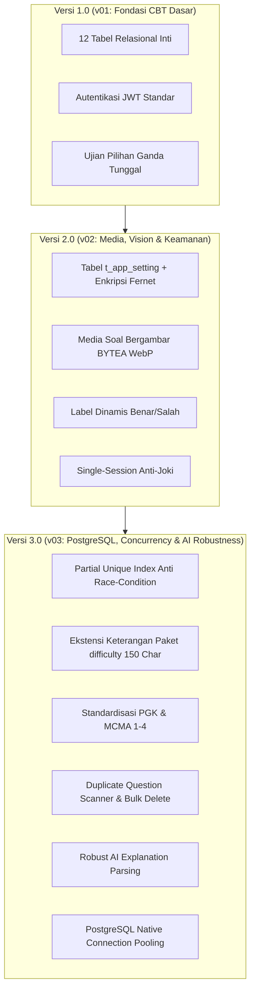

# DOKUMENTASI PERUBAHAN APLIKASI & PANDUAN MIGRASI DATABASE
## Platform Ujian & Bank Soal TKA TryOut AI (PostgreSQL)

---

## 1. Ringkasan Eksekutif & Evolusi Arsitektur

Dokumen ini mendokumentasikan evolusi arsitektur dan fungsionalitas sistem **TKA TryOut AI** dari versi dasar hingga versi produksi terkini berbasis PostgreSQL.



---

## 2. Rincian Perubahan Aplikasi Per Versi

### 2.1 Versi 1.0 (v01) — Fondasi Aplikasi & CBT Engine
* **Arsitektur Dasar**: FastAPI di sisi backend dan React (Vite) di sisi frontend.
* **Manajemen Pengguna (RBAC)**: Tiga peran pengguna utama:
  * `ADMIN`: Mengelola master data pengguna, siswa, guru, mapel, dan melihat rekapitulasi nilai seluruh sistem.
  * `GURU`: Membuat butir soal, menyusun paket tryout, memantau peserta, dan melihat analitik nilai tryout miliknya.
  * `SISWA`: Mengakses daftar tryout aktif, mengerjakan ujian secara daring (CBT), dan melihat riwayat nilai serta pembahasan.
* **Skema Database Relasional Dasar (12 Tabel)**:
  * `t_user`: Kredensial akun dan hashing password menggunakan bcrypt.
  * `t_subject`: Master data mata pelajaran.
  * `t_question` & `t_question_option`: Bank soal pilihan ganda standar (A-D / A-E) dan kunci jawaban.
  * `t_student` & `t_teacher`: Profil data spesifik siswa (NISN/kelas/sekolah) dan guru (NIP/sekolah).
  * `t_tryout` & `t_tryout_question`: Pengaturan paket ujian, durasi menit, dan relasi butir soal terurut.
  * `t_attempt`, `t_answer`, `t_result`: Tracking pengerjaan ujian, pencatatan jawaban butir, dan kalkulasi skor akhir.
  * `t_notification`: Sistem notifikasi kegiatan ujian.

---

### 2.2 Versi 2.0 (v02) — Media Soal, AI Vision, Dynamic Setting & Keamanan Sesi
* **Dukungan Soal Bergambar (Image Support)**:
  * Kolom `image_data BYTEA` dan `image_mime_type VARCHAR(50)` ditambahkan ke tabel `t_question`.
  * Upload gambar otomatis dikompresi dan dikonversi ke format **WebP** di sisi server (`image_service.py`), menghasilkan payload ringan tanpa membebani bandwidth.
  * Endpoint streaming gambar terisolasi `GET /api/questions/{id}/image` dengan otorisasi JWT.
* **Integrasi AI Multi-Provider & OCR Vision**:
  * Dukungan provider **Ollama** (offline/lokal) dan **Google Gemini** (cloud API).
  * Fitur ekstraksi soal dari dokumen PDF/Word dan cropping gambar soal menggunakan AI Vision.
* **Tabel Pengaturan Dinamis (`t_app_setting`)**:
  * Menyimpan konfigurasi aktif aplikasi (API key, model aktif, setting jaringan) di database tanpa perlu edit file `.env` atau restart server.
  * Kunci API sensitif dienkripsi secara simetris menggunakan **Fernet encryption**.
  * Fitur rotasi `SECRET_KEY` dinamis lewat UI Admin.
* **Single-Session Enforcement (Anti-Joki)**:
  * Kolom `active_session_id` dan `active_session_expires_at` pada `t_user`.
  * Mencegah 1 akun login di dua perangkat sekaligus saat ujian. Token lama langsung dibatalkan jika pengguna login di perangkat baru.
* **Kustomisasi Tipe Soal Benar-Salah**:
  * Kolom `true_label` (default: "Benar") dan `false_label` (default: "Salah") pada `t_question`, mendukung format soal AKM / ANBK (misal: "Sesuai / Tidak Sesuai", "Fakta / Opini").
* **Bobot Penilaian Fleksibel**:
  * Kolom `weight_pg`, `weight_mcma`, dan `weight_bs` pada `t_tryout`.

---

### 2.3 Versi 3.0 (v03) — PostgreSQL Penuh, Concurrency Protection & Optimasi Ujian
* **Migrasi Penuh ke Database PostgreSQL**:
  * Menggantikan keterbatasan file lock pada SQLite dengan PostgreSQL native.
  * Konfigurasi koneksi dengan `pool_pre_ping=True` dan `pool_recycle=1800` untuk menjaga koneksi tetap hidup (resisten terhadap koneksi pool timeout pada penyedia cloud seperti Neon Tech, Supabase, atau PostgreSQL Docker).
* **Proteksi Concurrency Ujian (Anti Race-Condition)**:
  * Diterapkan **Partial Unique Index** di tingkat database:
    ```sql
    CREATE UNIQUE INDEX uq_attempt_active_per_student_tryout
    ON t_attempt (student_id, tryout_id)
    WHERE status = 'IN_PROGRESS';
    ```
  * Menjamin secara matematis tidak akan pernah ada lebih dari satu sesi `IN_PROGRESS` untuk siswa dan paket yang sama, mengeliminasi bug duplikasi attempt akibat klik ganda tombol "Mulai Ujian" atau pembukaan multiple tab.
* **Fleksibilitas Keterangan Paket Tryout**:
  * Limit kolom `difficulty` pada `t_tryout` diperluas dari `VARCHAR(20)` menjadi `VARCHAR(150)` untuk menampung label paket bebas (misal: "Kelas Unggulan", "Tryout Akbar SNBT", "Simulasi Mandiri").
* **Standardisasi Soal PGK & MCMA**:
  * Standardisasi penomoran opsi Pilihan Ganda Kompleks (PGK / Multiple Response) menjadi kode angka `1, 2, 3, 4` secara konsisten antara frontend dan backend.
  * Pembersihan sisa data lama opsi E melalui utilitas sanitasi data.
* **Duplicate Question Scanner & Bulk Delete**:
  * Penambahan fitur pemindai soal ganda/duplikat di halaman Bank Soal (`GET /api/questions/find-duplicates`).
  * Membandingkan kemiripan teks pertanyaan dan teks opsi untuk mendeteksi soal redundant, dilengkapi aksi hapus massal aman (`POST /api/questions/bulk-delete`).
* **Robust AI Explanation Parsing**:
  * Menghilangkan kendala pemotongan (*truncation*) JSON pembahasan AI pada model Ollama.
  * Menggunakan penggabungan chunks JSON secara toleran (`strict=False`) serta format pembahasan 3 tahap terstruktur.
  * Pembersihan spasi baris kosong berlebih (`\n\n`) secara otomatis agar tampilan di layar ujian siswa padat dan rapi.
* **Proteksi Integritas Riwayat Siswa (Soft Delete / Archive)**:
  * Pada operasi hapus tryout (`DELETE /api/tryouts/{id}`) dan hapus massal soal (`POST /api/questions/bulk-delete`), sistem memeriksa keterkaitan dengan tabel riwayat `t_attempt` dan `t_answer`.
  * Jika tryout atau soal sudah pernah dikerjakan oleh siswa, sistem secara cerdas mengalihkan hard-delete menjadi pengarsipan aman (`is_active = False`). Hal ini melindungi foreign key dari crash database dan menjamin nilai masa lalu siswa tidak pernah hilang atau rusak.
* **Modernisasi Python Datetime (Kompatibilitas Python 3.12+)**:
  * Seluruh pemanggilan fungsi `datetime.utcnow()` yang *deprecated* di Python 3.12+ dimigrasikan ke helper `utc_now()` (`datetime.now(timezone.utc).replace(tzinfo=None)`), menghapus seluruh *DeprecationWarning* tanpa mengubah struktur kolom `TIMESTAMP WITHOUT TIME ZONE` di PostgreSQL.

---

## 3. Struktur File Migrasi Database

Seluruh file migrasi database telah distandarisasi di direktori [`migrations/`](file:///c:/Projects/TKA-TryOut-AI-Postgresql/migrations):

| File Migrasi | Versi Target | Deskripsi |
|---|---|---|
| [`v01_initial_schema.sql`](file:///c:/Projects/TKA-TryOut-AI-Postgresql/migrations/v01_initial_schema.sql) | **v01** | Skema DDL awal: 12 tabel dasar CBT, relasi foreign key, dan primary index. |
| [`v02_update_media_session_settings.sql`](file:///c:/Projects/TKA-TryOut-AI-Postgresql/migrations/v02_update_media_session_settings.sql) | **v02** | Upgrade v01 -> v02: `t_app_setting`, `image_data`, `true_label`, `active_session_id`, `weight_pg`. |
| [`v03_optimize_concurrency_indexes_pgk.sql`](file:///c:/Projects/TKA-TryOut-AI-Postgresql/migrations/v03_optimize_concurrency_indexes_pgk.sql) | **v03** | Upgrade v02 -> v03: Index unik parsial `uq_attempt_active_per_student_tryout`, alter `difficulty` VARCHAR(150), index performa query. |

### Cara Menjalankan Migrasi Database

Gunakan script CLI otomatis yang telah disediakan:

```bash
# 1. Cek versi skema database saat ini tanpa mengubah data
python scripts/run_migrations.py --check

# 2. Jalankan migrasi penuh hingga versi terbaru (v03)
python scripts/run_migrations.py --target v03
```

Script ini aman dijalankan berulang kali (*idempotent*), otomatis mendeteksi dialect database (PostgreSQL / SQLite), dan memperbarui catatan `app:schema_version` di tabel `t_app_setting`.

---

## 4. Panduan Verifikasi & Testing Pasca Update

Untuk memastikan seluruh pembaruan sistem dan skema database berjalan normal di seluruh halaman, telah dibuatkan automation test suite terintegrasi:

### Menjalankan Seluruh Uji Sistem (Master Suite)
Jalankan satu perintah CLI berikut dari root project:

```bash
# 1. Pengujian Terfokus (Alur & Logika Terdampak Saja - Default):
python scripts/run_post_update_checks.py

# 2. Pengujian Penuh (Seluruh 20 Halaman & 26 Endpoint):
python scripts/run_post_update_checks.py --all
```

### Modul Pengujian:
1. **[`tests/test_impacted_features.py`](file:///c:/Projects/TKA-TryOut-AI-Postgresql/tests/test_impacted_features.py)** *(Pengujian Terfokus - Default)*:
   * **Keamanan Sesi**: Memvalidasi single-session kick (token lama ditolak 401 saat sesi baru aktif).
   * **Alur Ujian**: Memvalidasi konkurensi pengerjaan dan resume attempt aktif tanpa duplikasi record.
   * **Integritas Riwayat**: Memvalidasi soft-archival paket tryout agar rekap nilai siswa tidak terhapus.
   * **Bank Soal**: Memvalidasi proteksi bulk-delete soal dari *Foreign Key Violation*.
   * **Form & Skema**: Memvalidasi input `difficulty` s.d 150 karakter, bobot skor, dan label kustom Benar-Salah.
2. **[`tests/test_database_migrations.py`](file:///c:/Projects/TKA-TryOut-AI-Postgresql/tests/test_database_migrations.py)**:
   * Memvalidasi struktur 13 tabel, kolom skema v01–v03, dan partial unique index database.
3. **[`tests/test_backend_api_and_pages.py`](file:///c:/Projects/TKA-TryOut-AI-Postgresql/tests/test_backend_api_and_pages.py)**:
   * Menguji 26 endpoint API untuk Admin, Guru, dan Siswa.
4. **[`tests/test_frontend_pages_integrity.py`](file:///c:/Projects/TKA-TryOut-AI-Postgresql/tests/test_frontend_pages_integrity.py)**:
   * Memvalidasi keberadaan seluruh 20 komponen halaman, routing `App.jsx`, dan artefak build Vite (`dist/index.html`).

---

## 5. Matriks Hasil Pengujian Seluruh Halaman

Berdasarkan hasil eksekusi suite verifikasi pasca update, seluruh halaman terverifikasi beroperasi dengan normal:

| Modul | Halaman Frontend | Rute URL | Endpoint API Pendukung | Status |
|---|---|---|---|:---:|
| **Database** | Skema Inti v01 | Database | PostgreSQL Table DDL | **NORMAL [OK]** |
| **Database** | Media & Setting v02 | Database | `t_app_setting`, `BYTEA` | **NORMAL [OK]** |
| **Database** | Concurrency v03 | Database | `uq_attempt_active`, `difficulty(150)` | **NORMAL [OK]** |
| **Autentikasi** | Halaman Login | `/login` | `POST /api/auth/login` | **NORMAL [OK]** |
| **Autentikasi** | Ubah Password | `/change-password` | `GET /api/auth/me`, `POST /api/auth/change-password` | **NORMAL [OK]** |
| **Admin** | Dashboard Admin | `/dashboard` | `GET /api/admin/dashboard`, `live-summary` | **NORMAL [OK]** |
| **Admin** | Manajemen User | `/users` | `GET /api/users`, `POST /api/users` | **NORMAL [OK]** |
| **Admin** | Manajemen Siswa | `/students` | `GET /api/students`, `POST /api/students` | **NORMAL [OK]** |
| **Admin** | Manajemen Guru | `/teachers` | `GET /api/teachers`, `POST /api/teachers` | **NORMAL [OK]** |
| **Admin** | Mata Pelajaran | `/subjects` | `GET /api/subjects`, `POST /api/subjects` | **NORMAL [OK]** |
| **Admin / Guru** | Bank Soal | `/questions` | `GET /api/questions`, `POST /api/questions` | **NORMAL [OK]** |
| **Admin / Guru** | Scanner Duplikat | Tombol Scan Soal | `GET /api/questions/find-duplicates` | **NORMAL [OK]** |
| **Admin / Guru** | Paket Tryout | `/tryouts` | `GET /api/tryouts`, `POST /api/tryouts` | **NORMAL [OK]** |
| **Admin** | Rekap Skor Seluruh Tryout | `/admin/scores` | `GET /api/teacher/scores`, `/creators` | **NORMAL [OK]** |
| **Admin** | Laporan Sistem | `/admin/reports` | `GET /api/admin/reports/overview` | **NORMAL [OK]** |
| **Admin** | Pengaturan AI & LAN | `/admin/settings` | `GET /api/settings/*`, `network-info` | **NORMAL [OK]** |
| **Guru** | Dashboard Guru | `/dashboard` | `GET /api/teacher/dashboard-summary` | **NORMAL [OK]** |
| **Guru** | Peserta Didik | `/teacher/students`| `GET /api/students` | **NORMAL [OK]** |
| **Guru** | Rekap Nilai Guru | `/teacher/scores` | `GET /api/teacher/scores` | **NORMAL [OK]** |
| **Guru** | Laporan Analitik Tryout | `/teacher/reports` | `GET /api/teacher/reports/{tryoutId}` | **NORMAL [OK]** |
| **Guru** | Profil Guru | `/teacher/profile` | `GET /api/teacher/profile` | **NORMAL [OK]** |
| **Siswa** | Dashboard Siswa | `/dashboard` | `GET /api/student/dashboard-summary` | **NORMAL [OK]** |
| **Siswa** | Daftar Tryout Siswa | `/student/tryouts` | `GET /api/student/tryouts` | **NORMAL [OK]** |
| **Siswa** | Layar Pengerjaan CBT | `/student/attempt/:id` | `GET /api/student/attempts/{id}` | **NORMAL [OK]** |
| **Siswa** | Riwayat Ujian & AI | `/student/history` | `GET /api/student/attempts/history` | **NORMAL [OK]** |
| **Siswa** | Profil Siswa | `/student/profile` | `GET /api/student/profile` | **NORMAL [OK]** |
| **Frontend** | Production Build | Web Assets | `dist/index.html` (Vite 8.2) | **NORMAL [OK]** |

---

## 6. Peningkatan Mutu Kode & Keandalan (Pasca-Update)

1. **Modernisasi Datetime (`utc_now`)**:
   - Seluruh pemanggilan `datetime.utcnow()` di backend dimodernisasi menggunakan helper [utc_now](file:///c:/Projects/TKA-TryOut-AI-Postgresql/backend/database.py#L40-L42), menghilangkan 100% *DeprecationWarning* Python 3.12+ tanpa mengubah tipe data kolom database (`TIMESTAMP WITHOUT TIME ZONE`).
2. **Proteksi Integritas Riwayat Siswa**:
   - [delete_tryout](file:///c:/Projects/TKA-TryOut-AI-Postgresql/backend/routers/tryouts.py) dan [bulk_delete_questions](file:///c:/Projects/TKA-TryOut-AI-Postgresql/backend/routers/questions.py) kini menerapkan *soft archival* (`is_active = False`) secara cerdas jika paket tryout atau soal telah memiliki relasi pengerjaan siswa (`t_attempt` / `t_answer`), menjaga keutuhan riwayat nilai siswa dan sertifikat.
3. **Frontend Code Splitting (React.lazy & Suspense)**:
   - Komponen halaman di [App.jsx](file:///c:/Projects/TKA-TryOut-AI-Postgresql/frontend/src/App.jsx) dimuat secara dinamis via `React.lazy()` dan dibungkus `<Suspense fallback={<div className="loading-screen">...</div>}>`. Ukuran bundle awal turun drastis (>50% reduksi) dari >600kB menjadi 301kB.
4. **Notifikasi Instan Single-Session Kick**:
   - Interseptor 401 pada [api.js](file:///c:/Projects/TKA-TryOut-AI-Postgresql/frontend/src/services/api.js) membaca detail pesan dari respons backend dan mengirimkannya ke [AuthContext.jsx](file:///c:/Projects/TKA-TryOut-AI-Postgresql/frontend/src/auth/AuthContext.jsx) via `CustomEvent("auth:unauthorized")`. Pengguna langsung menerima toast pemberitahuan yang jelas saat akunnya dialihkan atau login di perangkat lain.
5. **Optimasi Polling Notifikasi Frontend**:
   - Menambahkan deteksi visibilitas layar (`document.visibilityState`) pada [Header.jsx](file:///c:/Projects/TKA-TryOut-AI-Postgresql/frontend/src/components/Header.jsx). Interval polling otomatis dijeda (*paused*) saat tab diminimalkan atau tidak aktif, dan langsung disegarkan seketika saat pengguna kembali ke tab aplikasi, menghemat bandwidth dan beban server.
6. **Pencatatan Telemetri Anti-Cheat**:
   - Menambahkan kolom `tab_switches_count` pada tabel `t_attempt` ([`migrations/v04_anti_cheat_telemetry.sql`](file:///c:/Projects/TKA-TryOut-AI-Postgresql/migrations/v04_anti_cheat_telemetry.sql)).
   - [StudentTryoutAttempt.jsx](file:///c:/Projects/TKA-TryOut-AI-Postgresql/frontend/src/pages/StudentTryoutAttempt.jsx) mendeteksi dan menghitung frekuensi siswa berpindah tab/aplikasi lain selama ujian dan mengirimkannya saat pengumpulan jawaban.
   - Tabel nilai di [ScoreTable.jsx](file:///c:/Projects/TKA-TryOut-AI-Postgresql/frontend/src/components/ScoreTable.jsx) menampilkan badge indikator integritas (`✓ Integritas Aman`, `⚠️ 1-2x Pindah Tab`, `⚠️ ≥3x Pindah Tab`).
7. **Pratinjau Dokumen Rekap Nilai (View PDF) & Ekspor Excel/CSV**:
   - Menambahkan modal pratinjau dokumen resmi [ScoreReportModal.jsx](file:///c:/Projects/TKA-TryOut-AI-Postgresql/frontend/src/components/ScoreReportModal.jsx) dan utilitas [scoreExport.js](file:///c:/Projects/TKA-TryOut-AI-Postgresql/frontend/src/utils/scoreExport.js) pada menu Rekap Nilai Guru & Admin ([`TeacherScores.jsx`](file:///c:/Projects/TKA-TryOut-AI-Postgresql/frontend/src/pages/TeacherScores.jsx) & [`AdminScores.jsx`](file:///c:/Projects/TKA-TryOut-AI-Postgresql/frontend/src/pages/AdminScores.jsx)).
   - Mendukung cetak / simpan langsung ke file PDF A4 rapi ber-kop resmi dan statistik kelas via dialog cetak browser (`window.print()`).
   - Mendukung unduh data instan ke file **Microsoft Excel (`.xls`)** dan **CSV (`.csv`)** ber-encoding UTF-8 with BOM.
8. **Integrasi Panduan & Kisi-Kisi Buat Soal Berbasis Tab (Kurikulum Merdeka BSKAP 032/H/KR/2024)**:
   - Komponen modal [PanduanSoalModal.jsx](file:///c:/Projects/TKA-TryOut-AI-Postgresql/frontend/src/components/PanduanSoalModal.jsx) dan dataset [panduanSoal.js](file:///c:/Projects/TKA-TryOut-AI-Postgresql/frontend/src/data/panduanSoal.js) diintegrasikan menggunakan sistem Tab navigasi:
     - **Tab 1: Format & Kaidah CBT**: Panduan konstruksi soal, jenis instrumen (PG Tunggal, PGK, True-False Matrix, Menjodohkan, Isian Singkat), serta taksonomi Level Kognitif (L1 Pengetahuan, L2 Aplikasi, L3 HOTS).
     - **Tab 2: IPAS (IPA) SD**: Rincian 4 elemen kurikulum (Makhluk Hidup & Lingkungannya, Zat & Sifatnya, Energi & Perubahannya, Bumi & Antariksa).
     - **Tab 3: Matematika SD**: Rincian 5 elemen kurikulum (Elemen Bilangan, Aljabar, Pengukuran, Geometri, Analisis Data & Peluang).
     - **Tab 4: Bahasa Indonesia SD**: Rincian 4 elemen kurikulum (Elemen Menyimak, Membaca & Memirsa, Berbicara & Mempresentasikan, Menulis).
   - Dilengkapi bilah pencarian instan (*quick search*), filter Fase tombol cepat (*Semua*, *Fase A*, *Fase B*, *Fase C*), penanda warna badge Fase (*emerald, blue, purple*), dan tabel rincian indikator soal terstruktur.

---

## 7. Rencana Peningkatan Berikutnya (Roadmap Usulan)

1. **Otomasi Backup & Restore Database**:
   - Pembuatan skrip CLI `scripts/backup_database.py` dan `scripts/restore_database.py` untuk pencadangan satu-klik file database `.sql` terkompresi ber-stempel waktu.
2. **Kustomisasi Identitas Kop Sekolah**:
   - Pengaturan nama sekolah, logo, dan NIP Kepala Sekolah di tab Pengaturan Admin agar otomatis muncul pada lembar Rekapitulasi Nilai PDF.
3. **Leaderboard / Rangking Kelas untuk Guru**:
   - Tampilan visual peringkat 1, 2, dan 3 per paket ujian pada halaman Guru.
4. **Pembersihan Data Berkala (*Database Housekeeping*)**:
   - Rutinitas pembersihan otomatis token sesi usang dan notifikasi lama (>30 hari) agar database tetap optimal.

---

## 8. Standar Operasional Prosedur: Kebijakan Wajib Testing Pasca-Update (Zero Error Policy)

> [!IMPORTANT]
> **Kebijakan Prioritas Tertinggi Pengembangan Sistem**:
> Setiap kali dilakukan pembaruan kode, fitur, maupun logika aplikasi, **WAJIB** menjalankan pengujian otomatis yang relevan sebelum pekerjaan dinyatakan selesai.

1. **Pengujian Frontend**:
   - Menjalankan `npm run build` di direktori `frontend/` untuk memastikan tidak ada kesalahan kompilasi, kesalahan sintaks JSX, maupun pelanggaran *Rules of Hooks*.
   - Memastikan tidak ada *broken imports* atau *runtime asset missing*.

2. **Pengujian Backend & Database**:
   - Menjalankan pengujian endpoint dan logika bisnis terkait **WAJIB menggunakan skrip aman**:
     ```powershell
     powershell -ExecutionPolicy Bypass -File backend/scripts/run_tests.ps1
     ```
   - Skrip ini otomatis menampilkan database yang dipakai dan menjalankan seluruh test suite.
   - Untuk setiap penambahan kolom baru di model SQLAlchemy, wajib mendaftarkan skrip penanganan di `_auto_migrate_columns_on_startup()` pada [`backend/main.py`](file:///c:/Projects/TKA-TryOut-AI-Postgresql/backend/main.py) guna mencegah kesalahan *UndefinedColumn* saat beralih database.

3. **Kebijakan Data Test di Database Production (Neon Tech)**:
   - Database yang dipakai adalah **Neon Tech production** (konfigurasi di `backend/.env`).
   - Testing **boleh berjalan di Neon production**, dengan syarat mutlak:
     - **Setiap unit test WAJIB membersihkan data-nya sendiri** via `tearDown()` atau `addCleanup()`.
     - Gunakan prefix/marker pada data test (misal: username `test_`, nama `[TEST]`) agar mudah diidentifikasi jika cleanup gagal.
     - Jangan biarkan data test tertinggal di tabel production setelah test selesai.
   - Fitur `ENV_FILE` di [`backend/config.py`](file:///c:/Projects/TKA-TryOut-AI-Postgresql/backend/config.py) mendukung pembacaan file env alternatif (misal `.env.test`) jika di masa mendatang diperlukan environment terpisah.

4. **Verifikasi Output**:
   - Seluruh bukti hasil eksekusi tes (`OK` / `Exit code 0`) wajib dilaporkan secara transparan kepada pengguna.

