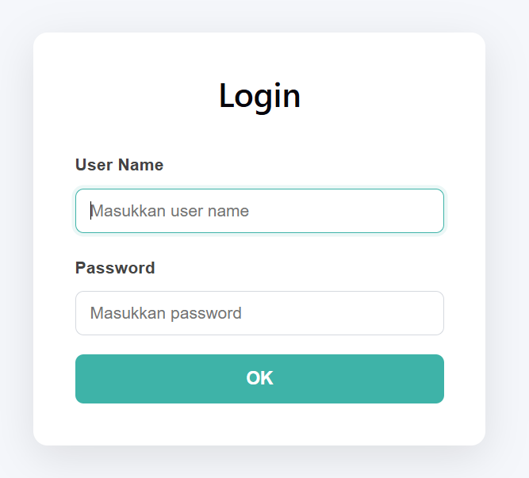

# Buku Panduan Penggunaan - TKA TryOut CBT & AI

Selamat datang di aplikasi TryOut berbasis *Computer-Based Test* (CBT) modern dengan dukungan Kecerdasan Buatan (AI). Buku panduan komprehensif ini akan membantu Anda mengoperasikan fitur-fitur dan mengenali antarmuka (UI) dari sudut pandang **Siswa**, **Guru**, dan **Administrator**.

---

## DAFTAR ISI
1. [Panduan Siswa](#1-panduan-siswa)
2. [Panduan Guru](#2-panduan-guru)
3. [Panduan Admin](#3-panduan-admin)

---

## 1. PANDUAN SISWA

Bagian ini dirancang untuk siswa/peserta ujian agar dapat mengerjakan soal TryOut dengan lancar dan aman.

### A. Halaman Login

*(Tangkapan Layar: Form Login Siswa)*

1. Buka aplikasi web TryOut pada browser Anda.
2. Pada halaman Login, masukkan:
   - **Username**: NIS/NISN atau username yang telah diberikan oleh pihak sekolah.
   - **Password**: Kata sandi akun Anda.
3. Klik tombol **Login**. Jika berhasil, Anda akan dialihkan ke layar utama (Dashboard).

### B. Dashboard Siswa & Memilih Ujian
1. Setelah login, Anda akan disambut oleh panel **Dashboard Siswa**.
2. Pada bagian daftar tryout, periksa nama paket, mata pelajaran, jumlah soal, durasi, dan status ketersediaan.
3. Pada tryout yang tersedia, klik **Mulai**.
4. Konfirmasi dialog browser untuk memulai. Timer mulai berjalan berdasarkan attempt yang dibuat server.

### C. Mengerjakan Ujian (Lembar CBT)
Antarmuka lembar pengerjaan soal dibagi menjadi dua area utama:
- **Area soal:** Menampilkan teks pertanyaan beserta gambar (jika ada) dan pilihan sesuai jenis soal. PG memakai pilihan tunggal, PGK-MCMA dapat memiliki beberapa jawaban benar, dan tipe Benar/Salah menampilkan pernyataan dengan label yang dapat dikustomisasi.
- **Area Kanan (Navigasi):** Menampilkan kotak grid bernomor yang melambangkan urutan soal, serta indikator **Sisa Waktu** di bagian atas.

**Cara Menjawab:**
1. Pilih opsi atau pernyataan yang sesuai dengan jenis soal. Pada PGK-MCMA, pilih semua jawaban yang menurut Anda benar.
2. Jawaban disimpan saat dipilih selama koneksi ke server tersedia. Klik **Selanjutnya** untuk berpindah ke soal berikutnya.
3. Anda bisa menggunakan grid nomor di sebelah kanan untuk melompat bebas ke soal yang belum dijawab. Nomor berwarna abu-abu berarti belum dijawab, sedangkan warna solid berarti sudah terjawab.

> [!WARNING]
> Backend memvalidasi waktu pengerjaan berdasarkan waktu mulai attempt dan durasi tryout. Browser berusaha mengirim jawaban saat waktu habis; koneksi jaringan tetap diperlukan untuk menyimpan/mengirim jawaban.

### D. Mengakhiri Ujian & Melihat Hasil
1. Klik **Kumpulkan Jawaban** jika sudah siap mengakhiri tryout. Tombol tersedia di bagian navigasi soal.
2. Anda akan dikembalikan ke Dashboard.
3. Navigasikan ke menu **"Riwayat & Hasil"** di *sidebar* sebelah kiri.
4. Anda bisa melihat total skor Anda, jumlah jawaban Benar, Salah, dan Kosong.
5. Buka detail hasil untuk melihat jawaban dan pembahasan per soal bila tersedia. Kualitas dan ketersediaan konten AI bergantung pada konfigurasi provider dan hasil yang ditinjau/dikelola guru.

---

## 2. PANDUAN GURU

Sebagai Guru, Anda memiliki akses penuh (melalui sidebar spesifik guru) untuk menyusun bank soal, mengelola paket tryout, dan menggunakan fitur kecerdasan buatan (AI) untuk membantu membuat dan membahas soal dalam sekejap.

### A. Manajemen Bank Soal
1. Masuk ke menu **Bank Soal** pada *sidebar* sebelah kiri.
2. Tabel akan menampilkan daftar soal yang telah Anda buat beserta filter mata pelajarannya.
3. Untuk membuat soal manual:
   - Klik tombol **"+ Tambah Soal"** di sudut kanan atas.
   - Pilih jenis soal (Pilihan Ganda, Benar-Salah, dll).
   - Ketik pertanyaan di kolom Editor. Anda juga bisa mengunggah file gambar ke dalam soal dengan menekan tombol **Upload Gambar**.
   - Isi pilihan/pernyataan dan tandai jawaban yang benar. Tipe PG memakai satu jawaban benar; PGK-MCMA dapat memiliki beberapa jawaban benar.

### B. Menggunakan Fitur "Import Soal dari Gambar" (AI Vision)
Fitur revolusioner ini sangat menghemat waktu Anda jika Anda memiliki soal dari buku cetak atau PDF ujian tahun lalu.
1. Masih di halaman Bank Soal, klik tombol **"Import dari Gambar"**.
2. Anda akan melihat sebuah area *dropzone*. Tarik file gambar (*.png, *.jpg) ke area tersebut atau klik untuk memilih file. (Sangat disarankan memakai fitur *Screenshot/Snipping Tool* dari Windows untuk mengambil gambar soal dari layar komputer).
3. Klik **Mulai Ekstrak**.
4. Aplikasi akan bekerja. AI Vision akan menyalin teks soal dan mendeteksi opsi jawabannya secara otomatis. Anda cukup meninjau kebenarannya dan menekan tombol **Simpan**!

> [!NOTE]
> Kemampuan membaca gambar sangat bergantung pada kejelasan resolusi foto dan performa "Mesin AI" yang dikonfigurasikan oleh Admin.

### C. Membuat Pembahasan Cerdas dengan AI
Alih-alih mengetik pembahasan yang rumit satu per satu, manfaatkan tombol Ajaib AI.
1. Saat sedang mengisi form Edit/Tambah Soal, *scroll* layar hingga ke bagian kolom "Pembahasan".
2. Di sana terdapat grup tombol **AI Assistant**:
   - `[🔍 Verifikasi Jawaban]`: Meminta AI untuk bertindak sebagai *proofreader*. AI akan mengecek silang apakah kunci jawaban yang Anda pilih sudah selaras dengan logika keilmuan.
   - `[✨ Bahas Singkat]`: AI akan menghasilkan draf pembahasan ringkas.
   - `[📚 Bahas Detail]`: AI akan menguraikan konsep dasar, menjabarkan status satu per satu opsi, hingga penarikan kesimpulan. Cocok untuk Matematika, Fisika, dan Eksakta.
3. Setelah proses *loading* selesai, teks pembahasan akan muncul di kotak editor. Anda bebas merevisinya secara manual sebelum menekan **Simpan**.

### D. Manajemen TryOut (Paket Ujian)
1. Buka menu **TryOut** di sidebar.
2. Klik **"+ Buat TryOut"**.
3. Isi parameter ujian: Nama Paket, Deskripsi (misal: "Kelas Unggulan"), Durasi, dan Batas Waktu pengerjaan (Buka/Tutup).
4. Setelah terbuat, klik tombol **"Atur Soal"** (Ikon Puzzle) pada baris tryout tersebut.
5. Anda bisa langsung "Mencomot" soal-soal dari Bank Soal ke dalam keranjang Tryout Anda.

---

## 3. PANDUAN ADMIN

Panel Admin memegang kendali atas infrastruktur sekolah, hak akses (*roles*), dan pengaturan kapabilitas AI yang mendasari semua fitur *smart* di aplikasi ini.

### A. Manajemen User (Pengguna)
1. Buka menu **Manajemen Pengguna**.
2. Anda akan melihat sub-menu untuk Siswa dan Guru.
3. Klik **Tambah User** untuk mendaftarkan akun baru.
4. Di panel ini juga, Admin memiliki otoritas tertinggi untuk mereset kata sandi atau memblokir akun pengguna yang bermasalah.

### B. Konfigurasi Mesin Kecerdasan Buatan (AI)
Sistem ini mendukung transisi mulus antara AI berbasis Cloud dan Offline.
1. Buka menu **Pengaturan** -> Tab **Kecerdasan Buatan (AI)**.
2. Pilih "Mesin Utama" yang akan diaktifkan untuk fitur *Import Gambar* dan *Bahas Soal Otomatis*:
   - **Gemini API (Cloud):** Sangat cepat, pintar, namun butuh koneksi internet. Admin wajib menempelkan (*paste*) **API Key** yang valid pada kolom yang disediakan.
   - **Ollama (Lokal):** Dapat dijalankan pada server yang dikelola sendiri; privasi dan akses data tetap bergantung pada konfigurasi server dan jaringan. Pastikan `Ollama Base URL` serta nama model sesuai dengan lingkungan Anda.
3. Klik **Simpan Pengaturan**. Perubahan ini akan seketika itu juga dirasakan dampaknya oleh Guru-Guru yang sedang merakit soal.

### C. Jaringan Lokal & Server LAN
1. Pada menu **Pengaturan**, buka Tab **Jaringan**.
2. Jika Anda menjadikan Laptop/PC Anda sebagai *Server Ujian* (dengan menjalankan skrip `run_server.py`), panel ini akan otomatis melacak IP Lokal Anda (contoh: `http://192.168.1.15:5173`).
3. Berikan alamat frontend tersebut kepada pengguna. Perangkat harus terhubung ke jaringan yang sama dan dapat menjangkau server; akses tetap memerlukan koneksi jaringan lokal.

### D. Backup Database Rutin
1. Buka menu **Pengaturan** dan pilih bagian **Backup**.
2. Klik **Backup Sekarang** untuk membuat backup SQLite. Backup yang tersedia dapat diunduh, dipulihkan ke database aplikasi, atau dipulihkan dari file SQLite yang diunggah.
3. Pemulihan akan mengganti data database aktif. Pastikan file benar dan tinjau konfirmasi aplikasi sebelum melanjutkan.
4. Di Docker Compose, service `backup` mencoba membuat backup SQLite tiap 24 jam. File backup berada pada folder host `backend/backups`; fitur bawaan ini tidak mencadangkan PostgreSQL.

> **Catatan:** Dokumentasi gambar antarmuka selain halaman login belum tersedia di repository. Nama menu atau susunan tab dapat berubah mengikuti versi UI.
